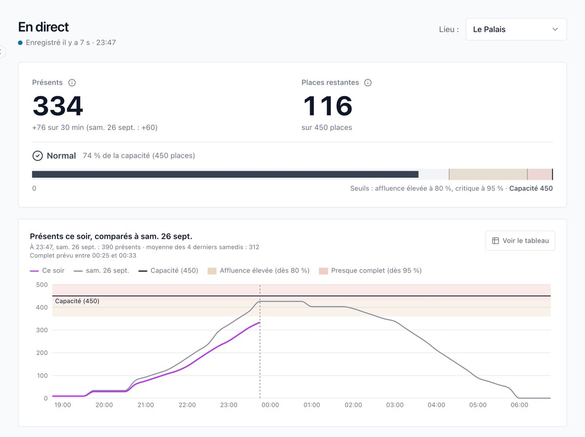
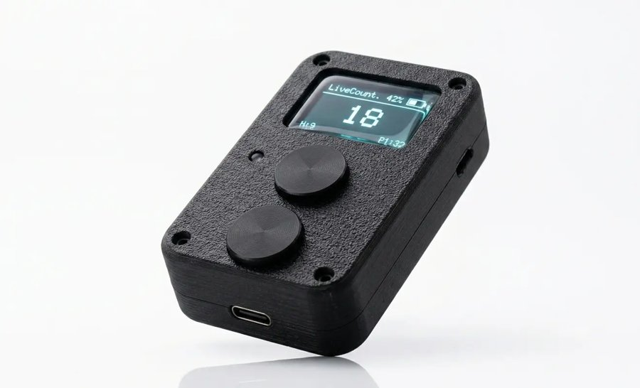
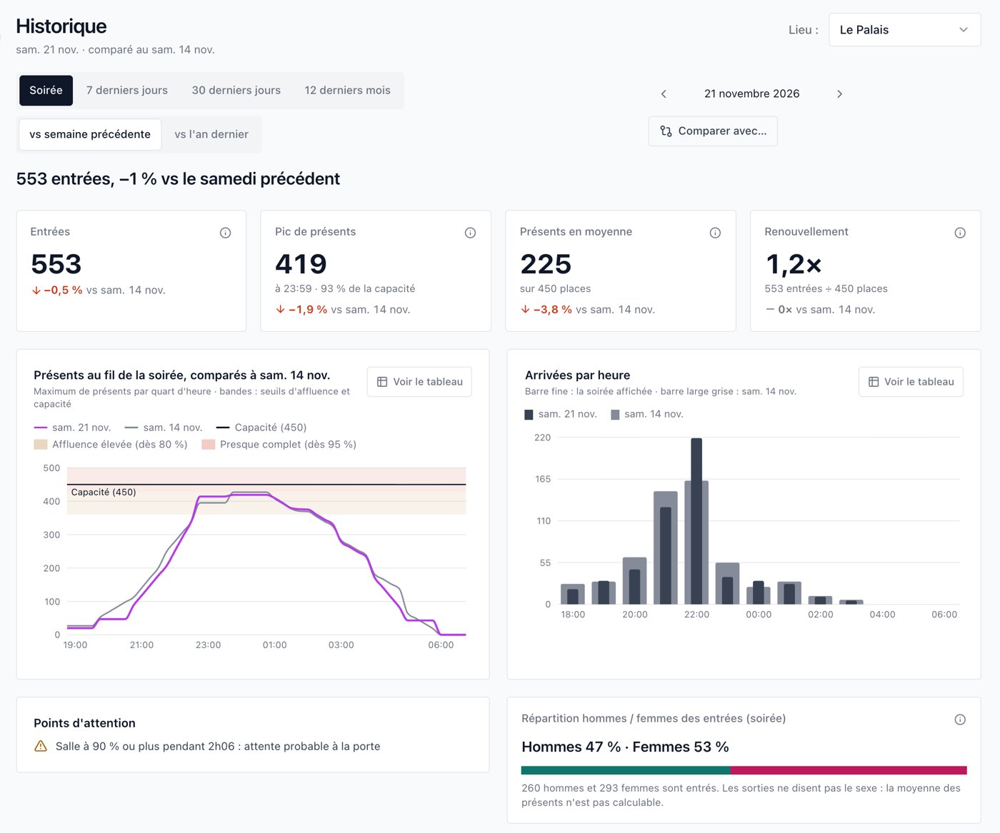
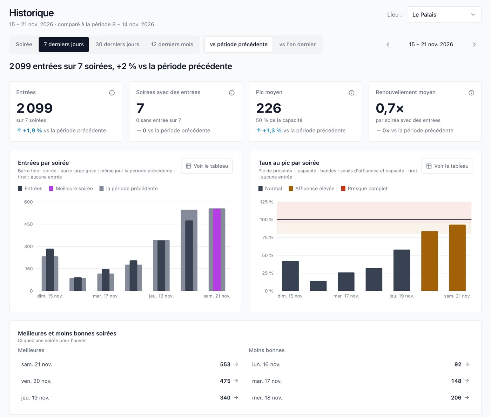
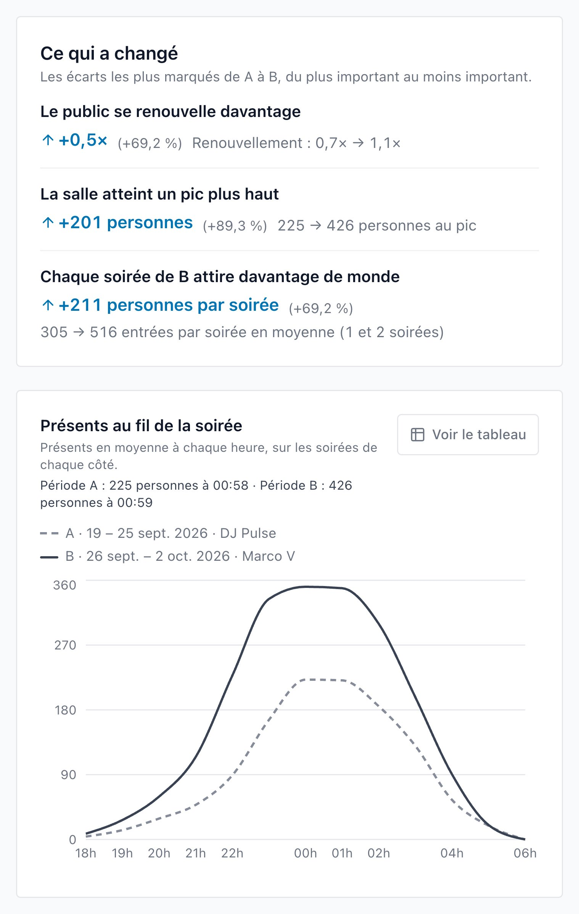
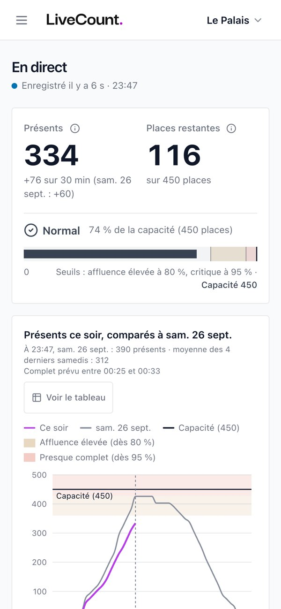

# LiveCount

**Pour les lieux qui comptent.** LiveCount tells bars, clubs and event venues how many people are inside, live, and turns every night into numbers they can learn from.

The staff counts at the door with a clicker. The manager follows the occupancy in real time on a phone or a laptop, and finds every past night in the history: the time of the peak, the effect of a DJ or a theme night, how a weekly party evolves month after month.

I co-founded LiveCount. The startup is part of the Pépite PON student entrepreneur program (2026-2027).

> This repository is a showcase. The product's source code is private.

## The idea

A venue manager already knows what works: Fridays are packed, the famous DJ brought people in. LiveCount does not replace that instinct. It measures it.

- **How many**: "it was packed" does not say if it was 20% or 60% more than a normal Thursday.
- **When exactly**: the time of the peak, the time the room empties, the moment an extra bouncer is needed.
- **Over time**: a night that loses 10% a month is impossible to feel from one week to the next.
- **Proof**: a number can be shown to a partner, to a DJ during a fee negotiation, to a bank.

## The clicker

| | |
|---|---|
|  | One button for entries, one for exits, a screen readable in the dark, USB-C, more than 72 hours of battery. Each click is sent instantly over WiFi. Audience segments (for example men / women, VIP) can be counted from the clicker. |

## The platform

### History, night by night

Every night as a curve against the same night last week, arrivals hour by hour, peak, average, turnover, and what deserves attention (here: the room stayed above 90% for 2 hours, so people were probably waiting at the door).

### History, week by week

Entries per night, peak rate per night against the capacity thresholds, the best and worst nights of the week, compared with the previous period.

### Compare and live on the phone

| | |
|---|---|
|  |  |

- **Live**: people inside, places left, capacity thresholds, tonight's curve against a reference night
- **History**: by night, 7 days, 30 days or 12 months, against the previous period or last year
- **Compare**: two periods side by side (two DJs, two formats) with what really changed
- Works on a phone at the door as well as on a laptop the next morning

## Under the hood

- **ESP32** clickers with an OLED screen
- **FastAPI** backend with SQLAlchemy and JWT auth, **PostgreSQL**
- **React + Vite + Tailwind** web app, mobile first
- Site in French and English, with a demo anyone can try without signing up

[livecount.app](https://livecount.app)

© 2026 LiveCount. All rights reserved.
